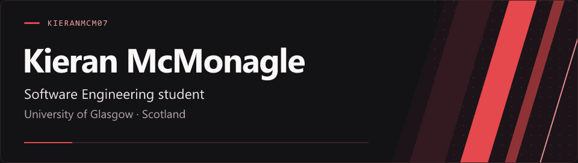
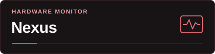
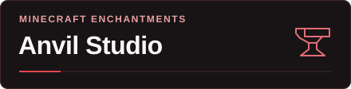
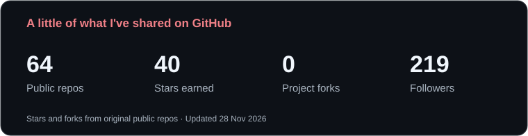

<picture>
  <source media="(prefers-reduced-motion: reduce)" srcset="./assets/header.svg" />
  
</picture>

Usually working on a Python project, or figuring out how something works.

[About](#about-me) · [Toolkit](#technical-toolkit) · [Projects](#projects) · [Activity](#contribution-activity)

## About Me

Hey, I'm Kieran, a **Software Engineering student at the University of Glasgow**, based in Scotland. I've been interested in programming since I was eight, when I started making things in Scratch. In high school I moved on to HTML and CSS, then picked up Python as I wanted to build more practical tools.

Most of my projects now involve **Python, desktop apps and automation**. I enjoy having something I can use on my own PC, whether that's a Windows utility, a tool for working with files, or a way to keep an eye on my hardware. Getting something working is satisfying, but I also like coming back to it later and seeing what I can improve.

I'm still learning as I go. At the moment, that means getting more comfortable with **Java and object-oriented programming**, exploring Linux, and understanding more of what's happening underneath the software I use. This profile is where I share what I've been making along the way.

## Technical Toolkit

<table align="center">
<tr>
<td align="center" width="150" height="105">
 
<b>Python</b> Main language
</td>
<td align="center" width="150" height="105">
 
<b>Java</b> Learning
</td>
<td align="center" width="150" height="105">
 
<b>HTML</b>
</td>
<td align="center" width="150" height="105">
 
<b>CSS</b>
</td>
<td align="center" width="150" height="105">
 
<b>MySQL</b> Basics
</td>
</tr>
<tr>
<td align="center" width="150" height="105">
 
<b>Git</b>
</td>
<td align="center" width="150" height="105">
 
<b>GitHub</b>
</td>
<td align="center" width="150" height="105">
 
<b>Linux</b> Learning
</td>
<td align="center" width="150" height="105">
 
<b>VS Code</b>
</td>
<td align="center" width="150" height="105">
 
<b>Windows</b>
</td>
</tr>
</table>

## What I'm Working On

<table align="center">
<tr>
<td width="250" valign="top" align="left">

### 🛠️ Building

**Python tools** that make everyday tasks easier, with cleaner code and better documentation.

</td>
<td width="250" valign="top" align="left">

### 🌱 Learning

**Java & OOP**, alongside algorithms, data structures and databases.

</td>
<td width="250" valign="top" align="left">

### 🔎 Exploring

**Linux & PC hardware**, from command-line tools to the sensors behind a system monitor.

</td>
</tr>
</table>

## Projects

A few things I've been building, from desktop apps and Discord tools to a Minecraft planner.

<table>
<tr>
<td width="50%" valign="top">

A Windows 11 cleanup app that shows you what it finds before you remove anything. Review file paths and sizes, choose the categories to clean, and look back through previous cleanups.

Python · Windows 11 · Desktop app

<a href="https://github.com/Kieranmcm07/Sweepkin"><b>View repository →</b></a>

</td>
<td width="50%" valign="top">

A Discord bot for moderation, tickets and day-to-day server management. Includes case history, AutoMod, activity tracking and music, with staff controls and setup checks inside Discord.

Python · discord.py · SQLite

<a href="https://github.com/Kieranmcm07/Discord_Moderation_Bot"><b>View repository →</b></a>

</td>
</tr>
<tr>
<td width="50%" valign="top">

A live view of CPU, memory, storage and network activity on Windows and Linux. Includes sensor readings, history and alerts, plus a compact gaming HUD for keeping an eye on things.

Python · Windows &amp; Linux · Desktop app

<a href="https://github.com/Kieranmcm07/Nexus_Hardware_Monitor"><b>View repository →</b></a>

</td>
<td width="50%" valign="top">

Plan Minecraft enchantments for Java and Bedrock. Choose your gear and books, then follow a combining order that saves levels, with step-by-step instructions, a visual graph and shareable plans.

JavaScript · HTML &amp; CSS · Web app

<a href="https://github.com/Kieranmcm07/Anvil-Studio"><b>View repository →</b></a> · <a href="https://anvil-studio.pages.dev/">Try it live</a>

</td>
</tr>
</table>

[See all my repositories →](https://github.com/Kieranmcm07?tab=repositories)

## GitHub Snapshot

<picture>
  <source media="(prefers-color-scheme: dark)" srcset="./assets/github-stats-dark.svg" />
  <source media="(prefers-color-scheme: light)" srcset="./assets/github-stats-light.svg" />
  
</picture>

## Contribution Activity

<picture>
  <source media="(prefers-color-scheme: dark)" srcset="https://raw.githubusercontent.com/Kieranmcm07/Kieranmcm07/output/github-contribution-grid-snake-dark.svg" />
  <source media="(prefers-color-scheme: light)" srcset="https://raw.githubusercontent.com/Kieranmcm07/Kieranmcm07/output/github-contribution-grid-snake.svg" />
  
</picture>

Generated automatically from my GitHub contribution graph.

Thanks for having a look around. Feel free to explore the repos or say hello.

